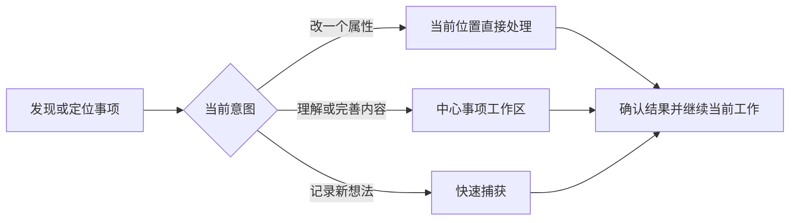

# 知事 · 前端与交互改版 PRD

版本：UX-1.0；日期：2026-10-13；状态：设计基线，待实现与体验验证。

**核心目标：以处理一件事的最短有效路径组织界面，让用户在当前关注的位置完成简单操作，在充分的空间里完成复杂工作。**

本文面向负责实现各模块的模型。它给出设计理念、交互契约、案例推导和验收方法；各模块据此补全自己的控件、布局与状态细节。案例用于说明如何作设计判断，不能被当作全部需求的穷举。

## 1. 来源、适用范围与文档关系

### 1.1 依据与可信度

| 来源 | 本文采用的依据 | 如何使用 |
| --- | --- | --- |
| ChatGPT「交互设计优化」，2026-10-13，[原聊天](https://chatgpt.com/c/6acd980f-9968-83e9-90ce-fb75cfa260c6) | 用户明确要求减少操作步骤，提高信息密度、友好程度与质感；不喜欢从中心转向狭窄侧边区域处理大量信息 | 作为本次改版的核心目标 |
| 同一聊天中的 ChatGPT 方案 | 列表行内编辑、中心详情工作区、轻导航、搜索过滤、自动保存、返回上下文、分场景密度 | 作为可采用的设计方向，不声称用户逐项确认了全部方案 |
| Codex「整理架构并生成完整 PRD」，2026-10-13，[聊天入口](codex://threads/01a12eba-7bcb-7f21-9b19-8694a16211f2) | 用户指出详情被卡片与安排挤占；要求页面直接录音；事项先独立记录、后组织；本人记录交给谁，同事不使用系统 | 作为已明确的产品约束 |
| [现有业务 PRD](PRD.md)、[M5 独立事项规格](M5_INDEPENDENT_ITEMS_DESIGN.md) | 状态、日期、单人分发、媒体、主树、引用、完成与删除守卫 | 继承这些业务语义 |
| 当前 `src/app/page.tsx`、`src/app/page.module.css` | 主内容容器上限980px并含内边距；桌面详情为最大460px右侧抽屉；存在遮罩/模糊、卡片与极小字号 | 作为源码层面的现状依据，不等同于浏览器视觉验收 |

聊天中的两张原截图未通过读取接口提供图片内容，因此本次没有直接审图。ChatGPT 对截图的385px、868px等描述是该聊天中的分析，本文不将其当作重新测量的事实。聊天提出的粘贴表格、智能工作台与智能录入，也不自动变成首期已确定功能。

### 1.2 本次改什么

改版覆盖所有面向用户的模块：捕获、收件箱、事项列表、详情、项目、组织选择器、搜索、进展、回顾，以及设置中的操作流程。优先处理当前已存在功能的操作体验；尚未实现的模块按同一理念设计。

整体方向是：**列表支持快速处理，详情承载深度工作，导航负责切换上下文。** 用户可以先记录，再组织；先看见当前需要的信息，再按需展开复杂能力。

本次保留个人工作台定位、原数据身份与业务规则。界面中的“交给谁”仍是本人填写的文本，不引入联系人目录、团队账号、在线接收或自动发送。项目和嵌套事项的后台契约继续按M5实施。正文表格、转写、系统推送等扩展需另行进入功能范围。

### 1.3 生效与冲突处理

本文是独立的前端改版 PRD，不重编号既有FR/AT/M任务。业务基线仍为v0.6.2；本文使用UX编号，全部为待开发目标。

对**前端呈现和交互行为**，本文优先于旧PRD中下列要求：

| 旧要求或现状 | 本次目标 |
| --- | --- |
| PRD 4.2的默认右侧宽详情面板 | 默认进入中心事项工作区；可用主内容路由或中心展开容器实现，不能继续把大量编辑放到边缘狭窄抽屉 |
| PRD 4.2.3 / 7.2的日常统一手动保存 | 单字段确认即保存，正文/标题编辑自动保存；提交型动作仍明确确认。保留统一写入协调、草稿、版本守卫和真实保存反馈 |
| PRD 8.3的附件独立动作前反复询问保存 | 正常联网时自动协调待保存内容与附件动作；只有冲突、失败、未完成录音或确有取舍才要求用户决定 |
| 功能平铺、各组信息同权重卡片 | 以阅读、判断、操作的优先级组织层次；同一任务流程跨模块保持一致 |

状态机、日期含义、完成守卫、主树/引用、媒体格式范围、认证与幂等规则继续以业务PRD及M5规格为准。冲突无法通过交互实现解决时，应明确指出需要改变的业务规则，不能在界面中暗改。

实现某个UX切片时，同步其涉及的技术协议、旧PRD段落及实施记录；历史验收报告保留当时结论。本文发布不表示旧实现已改版，也不表示自动保存、撤销或搜索已经可用。

## 2. 产品目标与设计取舍

### 2.1 用户打开产品要获得什么

用户应当能够迅速回答：有什么事需要我处理？这件事现在是什么情况？我能直接推进哪一步？需要深入理解时，能立即进入完整内容；处理完后，能继续刚才的工作。

成功体验是一条连续的路径：



### 2.2 取舍顺序

必须先满足“不丢输入、不误报保存、不改变业务语义”的底线。在此基础上，遇到设计冲突按以下顺序取舍：

1. 减少完成意图所需的步骤、寻找、视线移动和重新定位。
2. 让当前决策所需的信息充分可见，复杂度按需出现。
3. 保持操作语义清楚、反馈真实、跨入口一致。
4. 在不同尺寸与输入方式上提供可用路径。
5. 通过排版、比例、层次与细节形成质感。

界面简洁不能以隐藏高频入口为代价；信息密度不能靠缩小文字和点击面积实现；自动保存不能以静默覆盖为代价。对简单可逆修改，应以保存反馈与有效撤销降低确认成本。对发布、删除、结束成果或影响整棵子树的操作，应让用户理解影响再确认。

### 2.3 如何评价“更好用”

以下是改版验收目标，不是现状测试成绩：

| 维度 | 判断方法 |
| --- | --- |
| 路径成本 | 普通状态/优先级修改为“打开选项→选择”即可提交；不再额外进入详情、展开安排、点总保存和返回 |
| 定位成本 | 用户从列表与搜索打开事项后，返回仍保留筛选、排序、展开状态、滚动位置及可恢复的焦点 |
| 空间有效性 | 宽屏列表随可用区域扩展；普通详情首屏看见标题、关键属性和可编辑正文；长内容可在中心连续工作 |
| 高频入口 | 修改属性、快速捕获、记录进展不依赖找到页面底部或隐蔽的悬浮图标 |
| 反馈可信度 | 待保存、保存中、已保存、失败、本机草稿与冲突能够区分；刷新和另一设备读取可验证提交结果 |
| 跨模块一致性 | 同一事项在列表、搜索、项目、引用和详情中的属性编辑使用同一语义，读到同一原数据 |
| 可发现性 | 普通鼠标、触摸和键盘用户都有清楚的操作入口，快捷键只是加速路径 |

步骤统计从用户已看到目标事项/入口开始，不把键盘输入的每个字符算一步。进入等待需填原因、完成父事项需处理后代等业务步骤应单列，不能为达标删掉必要校验。

## 3. 跨模块设计原则

| 编号 | 原则 | 对实现的要求 |
| --- | --- | --- |
| P-01 | 按用户意图组织界面 | 首先识别用户要判断、修改、书写、提交还是组织，再选择入口与容器 |
| P-02 | 简单修改就地完成 | 状态、日期、优先级、交给谁等可在当前行/属性处编辑；弹出的控件靠近触发位置 |
| P-03 | 复杂工作获得中心空间 | 长正文、拆解、进展梳理使用主内容区，详情具有稳定身份与可直接打开的链接 |
| P-04 | 密度随任务变化 | 列表侧重扫描比较，详情侧重阅读编辑；空间优先给有决策价值的内容 |
| P-05 | 控件在需要时清楚可见 | 高频动作常可达，低频动作按需展开；空模块只提供简短添加入口 |
| P-06 | 保留工作上下文 | 弹出控件、修改、返回与切换不重置查询状态，不让用户反复找回同一事项 |
| P-07 | 保存成为可理解的系统行为 | 属性确认即保存，文本编辑自动保存；草稿和提交型动作保持不同语义 |
| P-08 | 同一语义使用同一交互 | 日期、处理方、状态、录音等跨模块复用行为与校验，外观可随布局调整 |
| P-09 | 先捕获，后组织 | 简单记录不要求分类、建项目或判断层级；组织操作不得复制原事项来代替移动/引用 |
| P-10 | 反馈发生在动作附近 | 字段错误显示在字段附近，保存结果清楚可查；成功提示不遮住下一步操作 |
| P-11 | 必要复杂度渐进出现 | 简单事项保持轻量；有正文、媒体、子项和历史时自然展开承载能力 |
| P-12 | 质感来自秩序 | 统一排版与间距、清楚状态、稳定焦点和细致响应；装饰不得抢占操作面积 |

未被案例覆盖的模块也必须遵守这些原则。允许实现者选择具体样式、尺寸、组件和排列方式；不能以“这个模块没写详细稿”为由退回长表单、卡片堆叠和多层确认。

## 4. 统一交互语言

### 4.1 五类意图及默认模式

| 意图 | 例子 | 默认交互 | 完成语义 |
| --- | --- | --- | --- |
| 定位与判断 | 搜索、过滤、看逾期与处理方 | 列表/结果直接呈现，过滤在当前上下文生效 | 不产生业务写入 |
| 轻量修改 | 改状态、日期、优先级、关注 | 行内控件或邻近弹层，明确选择后提交 | 提交选中的字段，局部反馈 |
| 持续书写 | 标题、正文、下一步 | 直接编辑，适当合并输入后自动保存 | 已确认的文本版本与本机未提交稿区分 |
| 记录与提交 | 新建事项、追加进展、添加已试听录音 | 准备内容，明确“创建/记录进展/添加录音” | 用户提交一条新的业务记录，防重复 |
| 组织与影响范围操作 | 移动、引用、提升小步骤、归档子树 | 同一上下文打开选择器；需要时预览影响后确认 | 关系变化与内容变化分别表达 |

高级面板只在用户确有复杂意图时打开。用户已经点击了一个属性，应进入该属性编辑；不能将任何点击都引导到整张详情表单。取消弹层只取消当前未确认选择，不能撤销之前已保存的其他字段。

### 4.2 点击、焦点与快捷键

- 标题/行主体打开事项；属性、完成动作、展开树和更多菜单各自处理本意图，不能冒泡导致同时打开详情。
- 单字段选择成功后保持当前位置与合理焦点；不整页闪白或重置滚动。触摸端无悬停，也应能找到关键操作。
- `Esc`先关闭当前最高层弹出控件；没有弹层时才返回来源上下文。正文输入中的快捷键不能劫持正常编辑。
- 快捷键采用常见习惯并提示，但所有关键流程必须有可见入口。中文输入法组合期间，Enter不得误创建事项、提交进展或触发保存后跳转。
- 键盘能够进入、修改并退出属性控件；焦点状态清楚。只用颜色表达状态或只靠鼠标拖拽完成操作均不合格。

### 4.3 错误、关闭与空状态

加载时保持页面结构；后台刷新不清空正在编辑的内容。字段校验失败保留输入并定位问题。未登录/会话失效保持可恢复稿，先完成登录再由用户确认恢复，私有内容不能泄露到另一个账号。

空状态应解释为什么为空并给出下一步：首次无事项可直接记录；筛选后无结果可清除条件；无正文可直接输入。空附件、小步骤、引用、历史模块不应每个占一块大空白卡片。

正常已保存内容离开不确认。保存失败或冲突离开时只询问真正存在的取舍；本机草稿成功落盘后可保留草稿返回，并说明尚未同步。正在录音/未提交媒体按现有媒体规则保护，不能因自动保存取消这些保护。

## 5. 信息架构与空间分配

### 5.1 导航、视图与全局操作

一级上下文沿用收件箱、我的事务、项目、回顾；今天、我要做、交给别人、等待、关注、全部等是我的事务中的预设视图，可做快捷入口，但需明确层次。空间作为归属筛选，搜索和快速记录在主要工作区随时可达，设置位于次要位置。

左侧导航是否常驻、如何折叠由实现者按可用空间设计。用户对侧边区域的批评核心是“阅读中心与操作位置割裂、内容容器太小”；因此详情优先进入中心工作区，导航降低视觉权重。无需为了形式一致强行删除一切侧栏。

统一“待处理工作台”属于后续可验证方案：先证明能减少用户选择栏目和定位事项的成本，再决定是否作为首页。不得凭空新增“别人等待我反馈”的后台状态，或未经定义用“长期没推进”给事项制造风险。首期可先记忆最近视图，并提供清楚的今天入口。

### 5.2 列表和详情采用不同密度

列表利用可用宽度，通过对齐的事项、状态、处理方、相关日期、项目/路径等信息帮助判断。不同预设视图可突出不同日期，但必须标明“计划/截止/跟进”，避免一列无语义日期。默认列需有选择，更多属性按需查看，不把全部数据库字段都展示为列。

详情正文置于主内容中心。关键属性紧凑呈现并直接编辑；正文、媒体、结构与进展形成连续工作区。系统元数据、字段变更与旧正文版本收进次级动态/历史入口，保持业务进展容易找到。

以下为首轮设计起点，均为**可调整参考值**，不是用户已确认的像素规格：

| 项目 | 参考 | 调整依据 |
| --- | --- | --- |
| 桌面导航 | 约180～200px，允许收起 | 标签清晰且不过度挤占主区；折叠模式须保持可发现性 |
| 桌面事项行 | 常规约44～52px，正文约14～16px | 保证能扫描和点击；长标题与辅助说明可增长 |
| 宽屏正文工作区 | 约800～1000px的布局空间 | 段落保持合适阅读行长，图片/代码可使用更宽区域；不要求每行文字铺满 |
| 手机触摸入口 | 主要目标约44px可触区域 | 信息可紧凑，但邻近目标不会难以点中 |

1660×900、1440×900桌面及390×844、360px窄屏是验收样本。桌面列表不能继续受980px居中容器导致的大面积闲置限制；手机不横向挤出六列小字，不隐藏关键日期而只留下标题。

### 5.3 视觉方向

采用克制、清晰的工作台视觉：统一字体层级与间距，分隔线和对齐承担组织工作，重点颜色服务于选中、状态、风险与主要动作。正常文字有足够可读性，避免当前大量9～11px文字成为常态；空白用于区分信息组，不能成为功能区之间的大面积断层。

可保留现有品牌绿并形成稳定色彩规则。阴影、圆角和动效适度，减少每行卡片的大边框与重复标题。动作响应应稳定，不因悬停位移影响对齐；展开与保存反馈不打断输入。减少动效偏好、对比度与屏幕阅读标签由实现者纳入组件验收。

## 6. 从案例推导设计，而不是复制案例页面

以下C-01～C-10均来自聊天场景或依据已知需求构造的验证场景。每个案例的“推荐模式”是本文设计决策，可在保持目标与验收结果的前提下优化。

### C-01：我只想把“门店开业效率评估”改成进行中

**诉求与问题：** 简单属性修改不应经历打开抽屉、寻找安排、改字段、保存、关闭。用户注意力已经在事项这一行。

**推导：** 单一、低复杂度意图应就地完成；可见属性同时也是入口。

**推荐模式：** 点击行内状态→选择进行中→提交并局部更新。进入等待/取消时，在同一邻近控件补充必要原因，不跳转整张详情。选择完成时仍走既有小步骤/主后代守卫。

**迁移到其他模块：** 搜索结果、项目行、引用目标的属性都应遵循相同规则；引用处若支持修改，须说明修改原事项会影响所有位置。

**验收：** 普通转换没有额外总保存；字段点击不会打开详情；网络失败可看见未提交结果并重试，不能显示已保存。

### C-02：交给张三的事项需要把跟进日期推迟两天

**诉求与问题：** 用户想对照多条事项判断处理方与时间，当前列表信息不足，又必须打开详情才能修改。

**推导：** 信息密度的价值来自支持当下判断；与决策直接相关的属性应同屏可读、可操作。

**推荐模式：** “交给别人/等待”视图突出交给谁、状态、下次跟进和逾期标记；点击明确标注的跟进日期就地调整。需要改截止日期时操作对应字段，不自动改另一日期。交给谁为文本输入及处理方式选择，不弹出团队成员系统。

**迁移到其他模块：** 每个视图按用户要做的判断选择关键信息，同一日期选择器复用，但字段语义不能混用。

**验收：** 无需深度详情即可读懂并完成改期；未设日期有可点击入口；同一天满足多个条件的事项仍按Task ID去重。

### C-03：我要补充背景、插图并持续写一段长正文

**诉求与问题：** 原详情侧边区域狭窄，安排卡片和元数据挤占内容；编辑正文需要转换或反复保存。

**推导：** 长内容属于深度工作，需要中心空间、连续阅读和直接编辑；正文是主要内容。

**推荐模式：** 打开事项→中心工作区显示标题、紧凑属性与完整可编辑正文。默认真正可视编辑；源模式/预览为次级切换。旧纯文本格式升级由系统无损兼容处理，不要求用户先点“转换”才能补充内容。图片/录音入口靠近内容；复杂结构按需出现。

**迁移到其他模块：** 项目目标、长结果说明等深度内容同样按连续工作区承载，避免把每个文本字段包装成独立卡片。

**验收：** 普通首屏可开始编辑，长内容不局促；自动保存过程不跳光标；不支持的Markdown或表格保留输入并说明范围，不能静默删格式。正文表格不因聊天建议自动纳入首期编辑器范围。

### C-04：刚收到电话反馈，我只想快速记录进展

**诉求与问题：** 进展输入框藏在长正文和多个模块之后，用户为一句记录滚动很远。

**推导：** 高频提交入口要随时可达，不能由数据展示顺序决定入口可达性；进展与正文语义分开。

**推荐模式：** 详情有稳定可达的“记录进展”，在当前事项内展开短输入区域，可附录音/证据；填写后明确提交。正文继续用于背景要求，系统字段修改收进动态，不把每次自动保存都堆成业务进展。

**迁移到其他模块：** 提交型高频动作可有靠近当前对象的快捷入口；无需为了提交先经过完整编辑表单。

**验收：** 长正文存在时不滚到底也能开始记录；重复提交不会产生两条进展；写了一半不自动成为正式记录；正文、进展、附件各自显示真实保存状态。

### C-05：连续处理十几条事项，进入详情后还要回来

**诉求与问题：** 打开详情后返回丢失滚动和筛选，每处理一条都要重新寻找。

**推导：** 进入深度工作不应丢掉来源上下文；连续处理是一条工作流。

**推荐模式：** 返回恢复列表、查询、排序、滚动、展开及焦点；详情支持上一条/下一条，并明确来源结果集。直接链接进入详情时，没有来源列表就不给伪造的前后项，可提供“返回我的事务”。

**迁移到其他模块：** 搜索结果、项目子树、回顾列表与引用位置都建立来源上下文，移动后旧事项链接仍可用。

**验收：** 编辑后事项退出当前筛选时，给出清楚反馈并保持相邻位置；前后切换以进入时的有序Task ID集合为基础，删除/不可访问项可跳过并提示。查询改变后新一次进入重建集合，不能把两套结果混用。

### C-06：随手想到“更换滤芯”，还不知道属于哪个项目

**诉求与问题：** 创建时提前选择项目、父级或日期，让记录变成分类表单。

**推导：** 捕获和组织是不同意图；输入成本越低越能积累真实事项。

**推荐模式：** 全局快速捕获输入标题→Enter创建；按需展开正文和媒体。后续移动到父事项下或启用项目视图，沿用原Task ID。项目内捕获提示默认上下文，并允许用户选择独立记录。

**迁移到其他模块：** 任何新建入口都要审查哪些字段真是必填；不得因当前容器复杂而让简单记录复杂。

**验收：** 无项目即可创建，中文输入法Enter不误提交；失败保留输入，网络重试不复制事项；移动后正文、媒体、历史保持。

### C-07：A先独立存在，后来放进B，也希望在C看到A

**诉求与问题：** 用户不希望收集时确定层级，也不希望在多个位置维护同一件事的副本。

**推导：** 内容身份独立于呈现位置；组织界面必须表达操作到底改变关系还是改变内容。

**推荐模式：** “移动到…”改变唯一主父级，“引用已有事项”增加展示位置；选择器搜索目标并显示主路径。深层结构可聚焦某节点、分段显示路径、按需展开，避免无限缩进。移除引用明确只移除此处关系。

**迁移到其他模块：** 搜索、今天、项目统计和详情都按原Task身份工作；移动/引用的术语与提示全局一致。

**验收：** C打开A修改后B读取同一内容；移除C引用后A存在；防环、全部后代完成守卫与统计继续按M5，无固定产品层数上限。

### C-08：手机上刚想起一件事，想直接说下来

**诉求与问题：** 语音入口若只要求上传文件，用户需要换应用录音再回来；窄半屏区域容纳不了内容。

**推导：** 功能入口应完成真实意图，移动端保持能力而调整布局。

**推荐模式：** 捕获/正文/进展附近提供“录制语音”；首次明确点击后申请权限，在原流程停止、试听、添加。手机详情全屏，录音状态与动作清晰，键盘弹出后仍可看到当前输入和提交入口。

**迁移到其他模块：** 手机使用紧凑行或必要的局部全宽选择器替代表格，不把桌面六列缩成小字；低复杂度选择器可用局部弹层，长正文必须获得足够工作空间。

**验收：** 不需准备文件即可录制；权限拒绝有清楚退路；停止不等于已上传，上传不等于已关联；中断、离开与草稿保护按媒体业务规则验证。

### C-09：我修改后网络断了，另一设备也改了同一事项

**诉求与问题：** 自动保存若只显示成功动画，可能掩盖未提交、重复写或静默覆盖。

**推导：** 减少步骤要建立在真实反馈与统一并发语义之上。

**推荐模式：** 同Task写入由统一协调器串行管理，已确认版本、当前编辑稿及待提交变更分开。失败保留稿并显示未同步；冲突展示双方内容/字段变化，允许重新选择或合并后提交。

**迁移到其他模块：** 属性、小步骤、附件、进展与正文都共享版本管理；网络重试是同一次业务请求，不能另造事项或进展。

**验收：** 无静默覆盖、重复进展或旧响应覆盖新输入；离开失败不会清稿；恢复联网后没有完整离线队列时，不后台无条件重放旧业务操作。

### C-10：刚误改了优先级，希望直接撤销

**诉求与问题：** 反复确认打断简单操作；只有“重新打开”又无法撤销其他字段。

**推导：** 可逆操作使用有效撤销，必要确认留给影响范围大的动作。

**推荐模式：** 成功后给短期“撤销”，实际提交恢复该字段的补偿操作并留新事件。撤销前检查当前字段仍是本次结果；有后续相关修改或业务守卫变化时说明无法直接撤销，进入核对流程。

**迁移到其他模块：** 第一阶段撤销优先支持简单属性；不能把删除恢复、重开事项、撤销进展写成同一个万能动作。

**验收：** 撤销不是只改前端外观；不抹掉事件、不回滚整个旧Task快照、不恢复他人/其他入口已经修改的字段。具体可撤销范围必须在模块设计中明确。

## 7. 模块契约与实现者的自由度

| 模块 | 必须交付的用户结果 | 实现者可自主细化 |
| --- | --- | --- |
| 应用框架/导航 | 全局记录和定位可达；上下文明确；主区有足够空间 | 导航样式、折叠方式、入口布局、断点 |
| 列表/收件箱 | 关键信息可扫描、属性可就地改；整理与完成语义分开 | 默认列、局部弹层、行密度、分组视觉、局部更新策略 |
| 事项详情 | 中心工作区、完整可编辑正文、高频动作可达、保存反馈与返回上下文 | 主内容路由或中心容器、属性排列、区段导航、深度内容布局 |
| 捕获 | 低必填、快速提交、按需展开；失败/重试不丢稿不重复 | 行内/全局捕获展开方式、输入焦点、媒体预览排列 |
| 进展/动态 | 进展方便提交与阅读，系统事件次级；事实不被改写 | 紧凑编辑入口、切换方式、分页与历史筛选 |
| 项目/结构 | 同一Task能组织和展开，移动/引用清楚，统计正确 | 树/分组布局、路径选择器、聚焦模式、非拖拽排序 |
| 搜索/过滤 | 无需先猜分类即可找事项；条件可见可清除，结果可操作 | 搜索位置、结果提示、过滤器排列、列表与结果复用 |
| 回顾/回收站 | 看清结果和卡点；恢复/删除动作影响明确 | 条件组织、结果密度、批量预览形式 |
| 媒体/录音 | 当前流程内添加、预览、播放；状态可信、失败可恢复 | 缩略图、播放器、局部展开及进度显示 |
| 设置/导出 | 用户理解操作结果与范围；备份状态准确可查 | 分组排版、确认样式、下载反馈；完整恢复仍按运维契约 |

批量操作、自定义列、命令菜单、额外视图可在证明减少高频成本后增补；不是为了“高级”默认加入。每个模块必须覆盖加载、空、编辑、提交、成功、失败、冲突和离开这些适用状态，而不是只画静态成功页面。

## 8. 自动保存、撤销与可靠交互的共同底线

本节约束用户能观察到的行为及实现的最低保障。具体定时、缓存库和组件结构由实现者决定，但不能只用前端debounce替代完整方案。

### 8.1 保存状态与提交粒度

| 状态 | 用户理解 | 要求 |
| --- | --- | --- |
| 编辑中/待保存 | 当前输入尚未提交 | 能继续输入，适当合并输入；中文组合未结束不提前提交不完整字 |
| 保存中 | 请求已发出 | 不锁住正文；随后新输入继续保留，不能被旧响应覆盖 |
| 已保存 | 服务端确认对应变更 | 仅对已确认变更显示成功；仍有新输入则继续待保存 |
| 失败，已保留本机稿 | 内容尚未同步 | 说明失败原因、重试或核对；保留本机稿必须确实落盘 |
| 冲突 | 服务端与当前基准不同 | 保留双方并暂停相关自动覆盖，用户核对后再提交 |
| 部分未提交 | 文本成功，媒体/进展等仍待提交 | 分别列明状态，不汇总成“全部已保存” |

属性在选择/确认时提交；标题与正文等连续文本采用合并提交，离开焦点或切换事项时及时协调。每次服务端接受的正文变更仍生成既有修订，不能为减少动态噪音删历史。界面可归并显示系统变更摘要，不改变原事实。

新建捕获、进展草稿、尚未添加的录音不会随停顿自动发布。保留“创建事项”“记录进展”“添加录音”这类明确提交动作。

### 8.2 同一事项统一协调写入

1. 同一个Task在各入口的待提交修改使用统一状态与写入协调；已确认数据、未提交稿、待发字段分开管理，不同时发送多个依赖同一旧version的写操作。
2. 优先级等修改只提交相关字段；不把陈旧的整张表单覆盖回服务器。内容自动保存与状态、小步骤、媒体、进展等独立事务串行协调。
3. 已发出的请求保留对应输入快照与requestId；因网络不确定重试复用原ID。已改变的载荷属于新请求，不能复用旧幂等键。
4. 成功响应更新已确认版本后，再合并仍未提交的新输入。对迟到响应、切换事项和组件销毁做身份/版本校验，不能把A的响应写进B的界面。
5. 属性保存或附件提交不得清理仍未提交的正文草稿。409保留当前稿与服务端数据，不能仅换一个expectedVersion就将旧正文原样强行写回。
6. 首期仍是在线提交加本机草稿；完整离线业务操作队列属于M9。失败操作是否继续、重试还是撤销，由清楚的状态与用户意图决定。

自动保存的技术设计需在对应切片明确flush、重试、离开、账号失效及跨设备冲突处理。旧“统一手动保存”的代码不能只通过隐藏按钮声称完成改版。

### 8.3 撤销范围

首期优先实现优先级、日期、关注等简单字段的撤销；普通状态在合法守卫内可支持，完成/取消/重开沿用生命周期规则。关系移动、子树归档/删除和进展提交的恢复另按其业务协议设计，不能承诺全部动作一键还原。

补偿请求使用新requestId和最新检查结果，留新事件；只恢复此次相关字段，并检查其当前值、后续变更和业务约束。若当前version已变化，先核对变化，不能直接提交旧快照。撤销失败明确显示，原成功结果仍可信。

## 9. 给实现模型的设计推导方法

### 9.1 遇到未覆盖模块时怎么做

在写组件前，为这个模块回答以下问题，并形成简短可评审说明：

1. **用户意图：** 用户在什么上下文，想完成什么结果？最常见的两个动作是什么？
2. **当前成本：** 现有路径要找什么、点什么、读什么、移动视线到哪里？哪些是业务必要步骤，哪些只是界面绕路？
3. **必要信息：** 为判断下一步必须同时看到什么？哪些内容可以按需展示？
4. **操作类型：** 属于轻量修改、持续书写、提交记录还是组织/范围操作？按第4节选择模式。
5. **空间与上下文：** 控件在哪出现？复杂内容在哪里工作？取消/成功/返回后用户落在哪里？
6. **可信反馈：** 保存、失败、冲突、撤销和未提交稿分别如何表达？触摸、键盘与窄屏如何完成？
7. **推导与验证：** 标明依据P原则和C案例，给出关键流程与反例，说明自主确定的细节及取舍。

不需要用户确认每个按钮位置、间距或弹层样式。按本文作常规细化并记录依据；只有改变业务含义、引入外部服务或扩大功能范围时，明确列出新决策。

### 9.2 每个模块的交付说明模板

```text
模块 / 对应UX切片：
用户意图与主要场景：
旧路径及问题：
新路径：
依据的P原则 / C案例：
必须同时呈现的信息与主次：
选择的容器、提交模式与返回行为：
加载 / 空 / 错误 / 冲突 / 离开处理：
桌面 / 手机 / 键盘路径：
自主细化的默认值及理由：
验证结果、剩余限制与需要同步的文档：
```

交付说明要解释具体选择怎样减少成本，不能只写“更简洁、更高级”。说明可作为开发任务中的短设计段落，无需为每个小控件另写长文档。

### 9.3 未知场景的推导示例：项目中移动一个深层事项

这是对原则迁移的演示，不是对整个组织模块的完整设计。

用户已在项目树中找到A，想把它放到B下：主要意图是组织关系变化，需要看目标路径与影响范围。依据P-02/P-06/P-09和C-07，选择从A旁的“移动到…”打开可搜索路径选择器；普通合法移动在预览后确认，不要求先打开详情、解除父级、返回项目再挂接。

提交后A的原ID、内容和历史保持，树局部更新；A退出当前分支时提示新位置，用户仍停在原工作上下文。防环/跨空间/后代影响由M5服务验证。失败保留目标选择，过期预览需刷新并重新确认。手机使用可读的路径选择而不是只靠拖拽。

实现者可选择搜索结果布局、折叠路径和弹层尺寸，但不能删除影响范围检查或用复制事项完成移动。

## 10. 改版切片、依赖与范围控制

以下UX任务全部待开发。优先级表达用户价值，开发先后还要考虑依赖。它们不替代M5～M9的领域功能开发，也不将旧验收重新标成通过。

| 编号 | 优先级 | 交付切片 | 前置与闭环 |
| --- | --- | --- | --- |
| UX-01 | P0 | 工作台空间、主内容详情与返回上下文 | 先提供稳定Task链接和来源上下文；保持当前保存可用作为迁移过程，最终保存行为由UX-02/03完成 |
| UX-02 | P0 | 统一写入协调、自动保存、状态反馈及有限撤销 | 先验证同Task混合写入、幂等、冲突与草稿；作为后续快速操作基础 |
| UX-03 | P0 | 信息列表及行内状态/日期/处理方/优先级编辑 | 接UX-02；桌面/触摸/键盘的完整简单修改闭环 |
| UX-04 | P0 | 低成本捕获、详情直接编辑与可达的进展/媒体入口 | 复用M4能力，依赖UX-01/02；涉及真机录音的验收保留M4/M7门槛 |
| UX-05 | P1 | 导航层次、搜索过滤、连续处理与视图信息选择 | 基础导航归UX-01；完整搜索依赖M6，前后切换强化来源集合规则 |
| UX-06 | P1 | 项目/主树/引用/回顾的统一交互 | 关系功能依赖M5，回顾查询依赖M6；按本PRD细化，不能提前宣称领域功能已实现 |
| UX-07 | P0首批起持续执行 | 跨模块一致性、响应式、键盘及体验回归 | 每个切片验收自己的适用用例，最终覆盖完整旅程 |

推荐顺序：UX-01建立中心空间与上下文→UX-02建立可信快速写入→UX-03/04闭环高频操作→UX-05/06推广到其他模块。UX-07贯穿执行，不能等最后才解决手机和错误路径。

第一阶段至少完成“看见列表→直接改属性→进入中心正文→记录进展→回到原位置→继续处理”，并覆盖保存失败和冲突。只把侧栏加宽、字号调大或旧保存按钮隐藏，不算P0闭环完成。

智能首页、自然语言提取、自定义列、批量处理和更多视觉视图属于后续体验增强候选。是否实施取决于真实使用收益及相应功能范围，不用它们阻塞基础闭环。

## 11. 验收：既验证功能，也验证工作路径

### 11.1 体验与可靠性场景

| 编号 | 场景 | 通过条件 | 主要关联 |
| --- | --- | --- | --- |
| UX-AT-01 | 宽屏扫描并修改普通状态/优先级 | 主区充分使用窗口；属性入口清楚；打开选择后即可提交，无详情/总保存/返回绕路 | UX-01/03，C-01/02 |
| UX-AT-02 | 收件箱“完成整理”与“完成事项” | 入口命名、图标语义与结果可区分；整理不误结束事项；结束守卫继续生效 | UX-03，P-08 |
| UX-AT-03 | 连续写长正文并修改日期 | 正文可持续工作，光标稳定；混合写入不互相覆盖，最后刷新后全部已确认变更一致 | UX-02/04，C-03/09 |
| UX-AT-04 | 长正文事项记录一句进展并加录音 | 入口无需滚到底；内容准备不自动发布；明确提交一次，媒体状态可区分 | UX-04，C-04/08 |
| UX-AT-05 | 筛选→打开→编辑→返回→下一条 | 查询、排序、展开、滚动及焦点保持；退出筛选、删除与无来源直接链接均有定义 | UX-01/05，C-05 |
| UX-AT-06 | 全局捕获后再挂接、添加引用 | 无项目即可记录；来源默认清楚；原Task ID/内容保持，移动与引用结果不同 | UX-04/06，C-06/07 |
| UX-AT-07 | 网络失败、响应丢失与重试 | 输入保留，失败不报成功；原请求重试无重复；旧响应不覆盖新稿或另一事项 | UX-02/07，C-09 |
| UX-AT-08 | 两设备改同一事项与草稿恢复 | 冲突不静默覆盖；双方可核对；未确认稿不被后台刷新清理 | UX-02/07，C-09 |
| UX-AT-09 | 简单字段撤销与有后续改动的撤销 | 补偿请求真实生效、留事件，只恢复相关字段；不满足守卫时明确说明 | UX-02/03，C-10 |
| UX-AT-10 | 手机捕获、改期、正文、录音与返回 | 窄屏无页面横滚；核心日期可读；触摸入口可用；键盘不挡住光标/提交；详情全屏 | UX-01/03/04/07，C-08 |
| UX-AT-11 | 键盘与中文输入法 | 可进入并完成主要操作；Esc逐层退出；Enter不会在中文组合输入期间误提交 | UX-03/04/07，P-08 |
| UX-AT-12 | 无内容、无结果、长标题与异常格式 | 各空状态给下一步；长信息不挤坏控件；格式不支持时保留原文并给明确路径 | UX-04/05/07，P-04/11 |
| UX-AT-13 | 深层项目、引用和不同入口编辑 | 深层路径可读，原数据一致，主树/引用不重复计数，生命周期与M5守卫一致 | UX-06/07，C-07 |
| UX-AT-14 | 新模块按理念自主设计 | 交付说明体现意图、原则和完整状态；流程可用，未退回卡片堆叠、多层表单及上下文重置 | 所有UX切片，第9节 |

### 11.2 验收方法与报告

在隔离数据中准备普通事项、长正文、等待/取消事项、失败请求、媒体、深层树与引用样本。首次页面、密集数据和手机布局都要检查。未完成的M5能力用明确标识的原型验证布局，不能用模拟树声称真实关系服务通过。

每个切片至少做以下适用验证：

- 记录代表流程改版前后步骤、寻找点与上下文是否保留，说明删掉的步骤为何不再需要。
- 真实浏览器检查桌面与窄屏，截图/操作记录证明中心空间、可读性与点击行为；录音须额外保留真机实测限制。
- 对自动保存、并发、幂等、状态守卫和撤销做真实服务集成验证；只测试前端数组或debounce函数不充分。
- 按改动运行现有类型/构建及相关领域回归，新增验证集中于真实风险，不为每个可逆样式调整新增机械测试。
- 报告列出实际通过的UX-AT、涉及的既有AT、未测设备/功能和剩余问题。新设计、源码存在、旧测试通过三者都不能代替用户路径验收。

## 12. 实现模型执行约定

先阅读本文，再读对应业务PRD章节、M5规格和当前实现。选定一个可闭环的UX切片，按第9节写简短设计说明，然后补齐该模块的布局、控件、反馈和边界；无需等待本文补出每个模块的完整视觉稿。

所有入口复用同一Task身份和业务服务。组件可以拆分为属性编辑器、事项工作区、来源上下文、写入协调器、捕获/进展及媒体能力，具体名称由实现者决定。避免在原单页中为列表、项目、搜索和详情分别复制状态机与保存逻辑。

切片交付时更新技术设计和涉及的旧PRD内容，记录实际验收情况。后台迁移继续遵守既有隔离库与备份要求，不能因前端改版重置正式数据。历史完成状态不回写成新交互已经通过。

**对未写明的细节，主动推导并完成；对业务语义、数据身份和可靠性底线，严格保持。最终交付应证明用户能以更短、更清楚的路径完成工作。**
