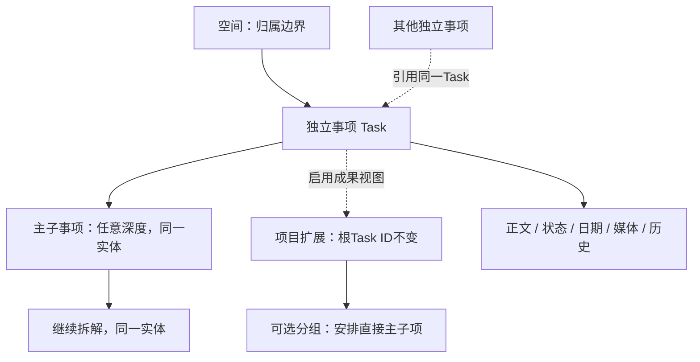

# 通用事务管理平台 · 产品需求文档

版本：v0.6.2；日期：2026-10-13；状态：独立事项、任意深度主层级与跨位置引用设计。本文规定目标行为，实际交付状态以实施清单和验收记录为准。

前端改版补充基线：[前端与交互改版 PRD · UX-1.0](FRONTEND_REDESIGN_PRD.md)（2026-10-13，待开发）。前端实现先读该文档；其第1.3节明确覆盖本文4.2的默认侧栏详情、4.2.3/7.2的日常手动保存，以及8.3的常规保存询问流程，改为中心工作区、就地操作和可靠自动保存。业务状态、日期、媒体范围与M5关系守卫仍沿用本文和M5规格；历史验收不等于新交互已通过。FR/AT/M编号保持。

关联：[竞品研究](COMPETITIVE_RESEARCH.md)、[技术设计](TECHNICAL_DESIGN.md)、[实施清单](IMPLEMENTATION_PLAN.md)、[编号与范围迁移](SCOPE_MAPPING.md)、[M5开发规格](M5_INDEPENDENT_ITEMS_DESIGN.md)。旧基线保存在docs/history/v0.5，历史任务记录按当时版本解读。

## 1. 产品定位与决策依据

### 1.1 产品定位

一个由本人维护的个人事务工作台，统一承载工作、生活、成长：先快速记录，再补足上下文、安排自己或别人处理，持续跟进，最后关闭与回顾。它同时容纳简单待办和复杂项目，但不要求每件小事经过完整流程。

同事不使用本系统。“分发”表示本人记录应该交给谁，实际沟通在系统之外；无联系人目录、邀请、接收、转派、多人权限或在线审批。

### 1.2 已知事实与设计建议

| 类型 | 内容 |
| --- | --- |
| 用户明确要求 | 多端使用、自部署；自己记录交给谁；完整详情与状态；Markdown/富文本、图片和语音；快速记录；大型项目拆解；整体重构PRD |
| 已选部署 | Mac mini、原生Node+launchd、SQLite、Funnel HTTPS的/tasks子路径；备份采用一致快照与云目录副本验证 |
| 本稿设计选择 | 统一事项、正文/进展分离、一个正文两种编辑方式、项目可选分组、任意深度子事项、结构化小步骤清单、录音先于转写 |
| 尚待实测或确认 | 主要手机、录音格式及中断体验、后台通知是否刚需、是否需要小时级日期、常开/重启、远端备份恢复 |

研究是官方资料对照，未做所有竞品账号或套餐实机体验；哪些是产品事实、哪些是本系统的取舍，见研究报告。新增默认值可评审，但不应被当作已实现能力。

### 1.3 成功标准

- 仅标题就能保存，详细字段和附件不阻挡简单捕获。
- 每条事项都能回答：要做什么、为什么、怎么做、交给谁、何时处理、已有何种进展。
- 简单步骤用清单；需要独立时间、状态或跟进的工作用事项/子事项。
- 项目结构、任务内容、日期和状态保持一致，列表/日历等未来视图不复制台账。
- 保存失败不误报成功，多设备不静默覆盖；文字、图片、录音可一起恢复和导出。

## 2. 整体设计逻辑

### 2.1 五步闭环

| 环节 | 用户的问题 | 主入口 | 核心能力 |
| --- | --- | --- | --- |
| 捕获 | 刚想到什么？ | 全局快速记录 | 标题、展开正文、图片/录音草稿、来源链接 |
| 整理 | 它属于哪里、怎么推进？ | 收件箱/事项详情 | 空间项目、下一步、日期、处理方、清单/拆解 |
| 行动 | 今天先做什么？ | 我的事务 | 今天、我要做、交给别人、等待、关注 |
| 跟进 | 事情发生了什么、何时再问？ | 事项详情 | 追加进展、证据附件、跟进日期、状态 |
| 回顾 | 结果如何，还有什么卡住？ | 回顾/项目详情 | 完成结果、历史、未安排动作、项目推进 |

### 2.2 四类信息分开

| 类别 | 表达什么 | 能否改写 |
| --- | --- | --- |
| 内容说明 | 背景、要求、参考、交付标准 | 持续编辑，保存版本 |
| 行动安排 | 状态、日期、处理方、优先级、下一步 | 修改并留下事件 |
| 结构拆解 | 项目、分组、子事项、小步骤 | 按结构约束编辑 |
| 进展与证据 | 何时发生了什么、图片/录音证据 | 进展只追加，附件移除留痕 |

正文不能替代进展日志；勾选清单不能冒充独立任务；交给别人不等于对方已收到；到期不能自动完成。

### 2.3 渐进复杂度

默认先看到标题、可直接编辑的完整正文和主要操作，不以摘要或安排卡片替代详情。日期、处理方、归属等辅助信息按需展开；添加图片和录音入口始终可见，已有附件随内容展示。普通事项不必选项目，普通项目不必创建分组，普通任务不必有子事项。桌面支持宽详情面板与专注编辑页，移动端使用全屏详情，核心顺序相同。

## 3. 用户场景与范围

### 3.1 端到端场景

| 场景 | 完整路径 |
| --- | --- |
| 临时记生活事 | 输入“更换滤芯”→保存收件箱→补型号图片与购买日期→完成 |
| 工作分发跟进 | 写“核实门店数据”→交给工程部门→正文说明口径→线下沟通→追加进展→等待并设跟进日期→核实后关闭 |
| 拍照/语音捕获 | 拍照或录音→预览→保存带附件事项→回头补正文；无标题时使用可编辑的临时标题并留待整理 |
| 大型项目 | 写目标与完成标准→分阶段→逐阶段创建事项→复杂事项拆任意深度子事项→逐项推进→人工确认项目成果 |
| 内容完善 | 从列表打开详情→可视方式编辑背景、列表、链接→切Markdown检查→保存→历史可回溯 |
| 长期学习 | 项目记录成果目标→安排下一步练习→周回顾；重复生成和AI拆解作为后续增强 |

### 3.2 首个完整个人版本V1

V1目标包括文字快速记录、详情正文编辑、有限格式的富文本/Markdown、图片和录音附件、结构化小步骤、项目分组、任意深度子事项、个人分发跟进、搜索回顾、多端在线及备份恢复。按M3～M8逐阶段实现；每阶段可独立使用。

后续V1.1：完整离线操作队列、经平台验证的系统推送、语音转文字、自然语言辅助与重复任务。提供录音能力不表示自动转写已经可用。系统键盘听写可作为用户输入方式，应用不承诺其质量。

不在当前交付：团队注册/邀请、联系人管理、交接审批、企业组织、多主父级图结构、甘特/依赖引擎、完整知识库、自动发外部消息、后台持续录音。表格、任意HTML、复杂排版、手写OCR及视频编辑不纳入首个编辑器。

## 4. 信息架构与页面

### 4.1 导航

一级入口保持“收件箱、我的事务、项目、回顾”。空间是全局归属筛选，搜索和快速记录是全局操作，账号/备份/录音设备等在设置。媒体不成为单独台账，也不新增联系人入口。

### 4.2 事项详情：统一完善任务的地方

任务详情是完善任务内容的主工作区。打开后直接看到并可编辑正文，日期与处理方是辅助安排，不能占据正文前的整屏空间。禁止把详情做成长串同等权重的独立卡片，也不设“只保存标题”的默认主按钮。

#### 4.2.1 入口与首屏

- 点击事项标题或列表行主体打开详情；辅助图标命名为“查看/编辑详情”。正文为空也显示可输入区域及“补充背景、要求、参考或交付标准…”提示，无需先寻找“添加描述”入口。
- 桌面宽屏采用右侧宽详情面板，目标宽度720～880px，并受视口约束；提供“展开编辑”进入专注布局。手机采用全屏详情，顶部保留返回与保存，不使用高度不足的底部半屏表单。
- 详情首屏顺序固定：紧凑操作栏 → 标题 → 正文编辑区。状态、归属、处理方与已设置的主要日期可在一行摘要中展示；过多时换行或展开，不显示成多个卡片。创建时间、整理状态、版本号收进“更多信息”，不占正文前的独立行。
- 在1440×900桌面和390×844手机参考视口，打开一条普通事项时，无滚动即可看到标题、正文入口和至少约180px高的正文区域。360px窄屏同样可直接开始写正文，界面无横向滚动；系统键盘弹出后编辑区可滚动到光标位置。

#### 4.2.2 以内容为中心的布局

| 区域 | 默认展示 | 具体行为 |
| --- | --- | --- |
| 顶部操作栏 | 关闭/返回、状态、保存 | 常驻可见；状态操作与保存语义明确，标识未保存状态 |
| 标题 | 可编辑大标题 | 不再单独做“标题卡片”，与正文一起保存 |
| 任务正文 | 完整正文编辑器 | 默认可视编辑；Markdown源与预览为次级切换，长内容在主内容区连续滚动 |
| 内容附件 | 添加图片、录制语音、添加文件；已有附件 | 入口贴近正文；已有图片显示缩略图，录音显示播放器，文件显示紧凑行；无附件时不放大块空状态卡片 |
| 小步骤/子事项 | 有内容时展示，无内容时为紧凑添加入口 | 位于正文和附件之后；复杂事项再逐步展开 |
| 任务安排 | 摘要＋“安排”折叠入口 | 展开后集中编辑优先级、三个日期、处理方式/交给谁、空间/项目、下一步与阻塞原因 |
| 进展与历史 | 紧凑“记录进展”入口及可展开历史 | 与正文区分；正文版本放在“更多→正文历史”，不抢占主保存位置 |

桌面面板默认使用连续的单列内容区；展开为专注布局后，宽屏可把安排放在窄辅助栏。手机保持相同内容顺序，安排折叠。安排内部采用紧凑标签与字段行，足够宽时日期可并排；空间不足时自然换行，不能为了并排导致字段不可用。分隔线、留白与字号表达层级，不给每一组信息重复边框、底色、大标题和长说明。

#### 4.2.3 保存与独立动作

- 标题、正文、优先级、日期、下一步及阻塞原因使用一个“保存”动作；保存按钮常驻顶部，显示未保存/保存中/已保存/冲突。正文区不再重复“保存正文”“保存标题”“保存安排”三个竞争按钮。取消/离开有未提交修改时明确提示，不能误以为草稿已同步到服务器。
- 归属移动、处理方式变更、小步骤操作、状态转换与追加进展仍是独立业务动作，安排区以“应用归属”“应用处理方式”等明确命名，不让它们假装包含在正文保存中。若仍有未提交的标题/正文/安排，先提供“保存后继续”“保留本机草稿后继续”“取消”；不得以刷新详情覆盖编辑区。
- 完成整理与完成事项分别命名，勾选清单项也不能被误解为完成事项。
- 版本冲突保留本地稿、展示服务器更新，用户决定采用哪份或手动合并。不能用“重新打开”伪装完整撤销。
- 本节是布局与交互验收要求；已有API或源码中的正文表单存在，不等于用户已能在首屏看见并完成编辑。

### 4.3 项目详情

顶部展示目标说明、完成标准、项目状态、成果日期与下一步；下方展示“未分组”及可选阶段/分组、各事项、完成/取消数；可筛选状态/处理方式并打开同一个事项详情。

阶段只是组织容器，拖动调整顺序同时提供菜单/键盘等价动作。可收起已结束项。整体进度显示明确分母，不能因嵌套重复计数产生虚假百分比。

### 4.4 我的事务与回顾

沿用今天、即将到期、我要做、交给别人、等待、关注、全部。回顾包含完成、取消、归档、回收站、等待未安排跟进、项目没有下一步。子事项在全局视图的呈现规则见第9节。

## 5. 数据对象与字段

### 5.1 对象模型

每条事项先独立存在，创建不要求父事项或项目；后续组织只改变关系。主关系每条事项最多一个父级，引用可以多处展示同一原事项。正文、媒体与历史始终挂在原Task ID下，不存进父事项正文或复制到其他位置。项目是可选扩展能力，旧Project保留ID并绑定根Task兼容迁移，详见[M5开发规格](M5_INDEPENDENT_ITEMS_DESIGN.md)。小步骤是轻量清单，明确提升后才成为独立事项。

### 5.2 字段默认值

| 字段 | 规则 |
| --- | --- |
| 标题 | 去首尾空白后1–200码点；文字创建唯一必填项 |
| 内容说明 | 一个正文，最多20,000码点；旧纯文本兼容；格式支持范围见第7节 |
| 空间/项目/分组 | 默认私人、无父级/项目/分组；主树同空间，最近项目为派生归属，分组仅安排项目根直接主子项 |
| 状态 | todo/in_progress/waiting/done/cancelled；默认待处理 |
| 已整理/我关注 | 默认false，独立于状态和处理方式 |
| 处理方式/交给谁 | self或other；默认self/空；other时文本1–100码点，不关联联系人 |
| 优先级 | 无/低/中/高，默认无 |
| 计划/截止/下次跟进 | 默认空，YYYY-MM-DD；产品时区Asia/Shanghai |
| 下一步 | 可空，最多500码点 |
| 等待/阻塞/取消原因 | 各最多1,000码点；等待、取消时对应原因必填 |
| 结果说明 | 可空，最多5,000码点 |
| parent/引用/小步骤/附件 | 默认无；约束见第8、9节 |
| 系统字段 | 创建、更新、结束、归档、删除时间与version由服务维护 |

字符串长度按Unicode码点；日期验证真实日历；空白标题拒绝。创建仅媒体时临时标题由产品规则生成，不把原始文件名当成强制标题。

## 6. 捕获与收件箱

### 6.1 两档快速记录

- 紧凑：标题输入、Enter保存；Shift+Enter展开详情输入。全局按钮与应用前台快捷键打开相同组件，不承诺PWA可监听操作系统全局快捷键。
- 展开：正文、添加图片、录制语音、添加文件、来源链接及可选空间/项目；字段均可晚些补。“录制语音”直接在当前页面录音，不先要求用户到其他应用生成文件。来源链接存原URL与可选展示名称，不自动抓取网站内容。
- 从全局新增默认私人/未整理；从项目内新增继承项目/空间并已整理。项目内可主动送回收件箱，只将已整理标记改为false，保留空间/项目/分组；改变归属须显式移动。
- 批量粘贴多行先提供“单个正文/多条事项”选择和预览，不自动拆开；批量操作按一批请求去重、整批原子提交；任一条校验失败整批不保存，逐条指出错误，修正内容后使用新请求ID再次确认，网络重试复用原ID；首版每批最多50条。

### 6.2 媒体捕获与草稿

标题为空但有图片或有效录音时生成“图片记录/语音记录＋上海日期时间”的临时标题；保存为普通Task，不生成第二套便签实体；全局捕获未整理，项目内捕获沿用项目归属/已整理规则。用户可随时改标题。

保存前显示附件/录音预览；有未完成上传的记录标为本机草稿，不能显示完整保存成功。文件失败可重试或移除，正文不丢。若选择“先保存文字”，需明确哪些附件未提交。

### 6.3 整理

收件箱查活跃且未整理事项，不是生命周期状态。编辑归属或日期不自动清空收件箱。操作为“完成整理”，已完成/取消自动已整理。未整理且到期的事项可出现在今天。

## 7. 详情正文与记录体验

### 7.1 一个正文，两种编辑方式

采用共同支持范围的Markdown正文作为内容源，默认提供真正的可视编辑模式，另提供Markdown源编辑与预览。可视模式中点击粗体、标题或列表后，在编辑区直接看到并继续编辑对应格式，不要求用户阅读或输入`**`、`#`等标记；“在源文本中插入标记的工具栏＋只读预览”只能作为过渡实现，不能作为可视编辑已交付的证据。支持段落、三级标题、粗体、斜体、删除线、列表、引用、代码、链接，以及本机上传图片引用。可视编辑不需要用户懂Markdown。

同一正文不维护互不一致的HTML与Markdown版本。切换前检查当前内容能否无损表示；不支持的语法保留源稿并提示，不能静默删除。粘贴外部富文本只保留支持的样式，提供粘贴纯文本选项；任意HTML不执行。外部图片只作为链接，上传成为本机附件后才预览。

结构化小步骤在正文下方独立维护。Markdown的`- [ ]`导入时提示转为小步骤或保留静态文本，不产生第二套可互动完成状态。

### 7.2 保存、草稿和正文版本

按4.2.3统一明确保存，显示“未保存/保存中/已保存/冲突”；本机按当前账号、事项ID、基准版本持久保存编辑草稿，不视为服务端同步或完整离线任务操作。恢复草稿先比较服务器版本，冲突保留双方。

成功保存后清理已提交草稿；退出账号前提示未提交内容，确认退出后清理私有草稿。手机返回/关闭、网络失败、重新进入详情不应静默丢失文字；无法保留媒体草稿时明确提示平台限制。

每次正文保存生成内容版本与一条更新事件；时间线显示摘要，正文历史可查看旧内容及复制到新稿，不覆盖原版本。

### 7.3 进展与结果

进展去空白后1–5,000码点，可带附件，按服务器记录时间追加；补录过去沟通在文本中注明日期，不让客户端重排事件。正文描述“这件事是什么”，进展描述“刚发生什么”。所有反馈由本人记录，不伪造外部人员账号或操作。

错误进展追加更正；附件可移除但历史留“附件已移除”标记。结束前结果说明可选，复杂事项建议说明成果及证据，仍由本人完成。

## 8. 图片、文件与语音

### 8.1 附件模型与交互

首个版本允许JPEG/PNG/WebP、PDF、TXT/Markdown，以及支持播放的录音格式；图片≤10MiB/张，普通文件≤20MiB，音频≤25MiB、应用录音最长5分钟；这些是产品默认值，可据实测调整并回写文档。其他类型给明确拒绝信息。

附件关联一个事项，可标为正文引用、进展证据或普通附件。上传显示进度与失败，文件验证后才变为可引用。重复提交同上传请求不重复挂载；不按同文件名合并。

正文删图片引用不删除文件；从附件区移除只软移除关联，原进展留占位。仍有正文引用时先提示并在同次保存中移除引用；其他历史版本不能因此被改写。首版不自动物理清理，后续保留策略另立项。

所有读取均需要登录，包括缩略图、下载和音频Range请求；不放公共静态目录。备份需含数据库、文件、清单与checksum；JSON包含元数据不等于二进制导出，完整导出另有打包格式；所有导出排除本机草稿与未关联staging，并明确这两类尚未提交。

### 8.2 语音分三层

| 层次 | 用户得到什么 | 阶段 |
| --- | --- | --- |
| 页面录音附件 | 在当前页面调用麦克风录制、停止、试听、重录、保存、播放；导入已有音频为另一入口 | M4首版必需；不承诺后台录音 |
| 语音转文字 | 原音频＋可编辑转写，失败仍保留录音 | M9候选，需明确服务、数据路径及费用 |
| 语义拆解 | 从文字提议标题、时间和多个事项，用户预览确认 | M9候选，不自动提交或对外沟通 |

语音的首要入口是“录制语音”，由页面调用设备麦克风；“上传已有音频”是并列的补充/降级入口。两者最终保存为同一种音频附件，但交互流程不同。V1录音不依赖转写、不自动写入正文；播放器旁明确显示“录音附件”。

### 8.3 页面内录音的完整流程

入口在任务详情正文附近、展开快速记录区，以及追加进展的附件入口；使用同一套录音交互。已有任务关联该任务，未保存的新任务关联当前捕获草稿；追加进展时须与该次进展明确关联。

| 状态 | 页面显示与操作 | 保存规则 |
| --- | --- | --- |
| 未开始 | “录制语音”，旁边为“上传已有音频” | 不申请麦克风，不创建空附件 |
| 请求权限 | 首次明确点击后申请麦克风；显示正在连接，可取消 | 拒绝后给出权限说明、重试、导入音频/改写文字入口 |
| 录音中 | 明显的录音指示、实时计时、5分钟上限提示、“停止”“取消录音” | 不显示已保存；不允许同页面同时开第二段录音 |
| 停止处理中 | 等待取得最后音频片段，释放麦克风 | 未取得有效音频给失败提示，不生成语音记录 |
| 待确认 | 播放/暂停、时长、可编辑名称、“重录”“添加录音”“放弃” | 试听成功仍是本机未提交片段；重录/放弃前确认丢弃当前片段 |
| 上传/关联中 | 进度、取消、错误与重试 | “添加录音”启动上传；只有上传校验及关联成功才显示已保存 |
| 已保存 | 紧凑播放器、名称、时长、下载/移除操作 | 刷新或在另一已验证设备打开可播放；移除关联留痕 |
| 失败/中断 | 明确错误、可用片段试听、重试或放弃 | 保留已取得的有效片段和文字，不把部分提交冒充完整成功 |

已有事项点“添加录音”可独立提交附件；如标题/正文有未保存修改，沿用4.2.3的保存或暂存确认，关联完成不刷新覆盖编辑稿。新建捕获或未提交进展的录音先加入该草稿的待提交附件，待“保存事项”或“记录进展”时完成关联，不能提前伪造已提交的事项/进展。

- V1提供开始、停止、试听、重录、保存，不要求暂停续录、剪辑、波形编辑或后台录音。停止后可继续添加另一段，形成独立附件；不自动拼接。
- 达到5分钟或大小上限时自动停止，尝试保留上限内有效片段并进入试听，提示停止原因；越界或损坏内容不得当作成功附件。
- 离开详情、关闭录音区、切换任务或退出账号时若正在录音，先确认停止/保留或放弃，再释放麦克风。试听阶段未提交的片段同样有离开提示；本机草稿保存成功与上传成功分别显示。
- 切后台、锁屏、来电或设备断开时停止并尽力保留已取得片段，返回后提示“录音已中断，请试听检查”；受浏览器限制可能没有可恢复片段，必须如实提示，不保证后台录制或完整保留。
- 在目标手机与桌面浏览器验证权限、真实录音格式、停止收尾、上传及跨设备播放；仅有录音探针页或文件上传接口，不满足页面录音交付要求。
- 全程不自动发送到转写/AI服务。语音转文字和智能拆解按M9另行设计。

### 8.4 图片与文件的添加体验

- 正文附近始终可见“添加图片”；桌面支持选择文件、拖拽与粘贴，手机支持设备提供的拍照或相册选择方式，并保留普通文件选择退路，不假定所有浏览器提供同样的相机菜单。
- 选图后立即显示本机缩略预览、名称与移除操作；上传时逐项显示进度，失败项可单独重试。未提交预览明确标记，不能误认为刷新后已存在。
- 在正文光标位置明确选择“插入正文”时才添加图片引用；普通“添加图片”默认进入任务附件区，不自动修改正文。上传完成后可插入，失败保持文字及插入意图，不插入失效链接。
- 保存的图片点击可放大；普通文件使用紧凑名称/大小/下载行，语音使用播放器，不以相同大卡片展示三类内容。
- 新建捕获可只有图片或录音，按6.2生成临时标题；图片/音频失败不会清空已填写的标题与正文。进展证据关联到进展条目，不能与任务普通附件混淆。

## 9. 独立事项、组织与大型任务拆解

本节取代旧“一层子事项”设计。执行细节见[M5开发规格](M5_INDEPENDENT_ITEMS_DESIGN.md)，属于未完成M5；当前代码和历史报告不因设计改变而自动通过。

### 9.1 先记录，再组织

- 创建只要标题或有效媒体，不先选项目/父级；每条事项都有独立ID、正文、状态、安排、媒体和历史。
- 单一动作可直接推进；需要拆解时在任何事项下创建或挂接已有事项，可逐层展开，不设业务层数上限。小步骤用于无独立安排的轻量清单。
- 同一主树每项最多一个直接父级；可随时移动到另一事项下或解除父级。移动是一笔操作，不要求先解除再挂接；原ID、内容、处理方、日期、整理标记不变。
- 项目是事项的可选成果视图。启用后保留原Task作为目标记录，扩展完成标准、成果日期、暂停及项目概览，不创建内容重复的替代事项。启用项目不打散后代，允许嵌套项目视图。

### 9.2 主层级、分组与展示

- 主层级是一片树，所有主后代同owner/空间；父级不限定为根Task，禁止自己包含自己或挂到自己的后代。无固定一层/三层/七层上限；按需加载、折叠和聚焦节点，不一次渲染整树。
- 桌面拖拽与菜单/键盘“移到…”等价；手机以搜索目标、路径预览和确认完成移动，深层路径折叠展示，不能靠无限横向缩进造成溢出。
- 主事项移动时其全部主后代一起移动，跨空间同时调整主子树空间；项目归属派生为最近启用项目的祖先（含自身）。外部引用不随主移动搬家，仍指同一ID。
- 可选分组仅组织项目根直接主子项，同项目命名1–80码点、可排序，“未分组”为系统查询区。更深层直接依靠事项层级组织，不强迫沿用祖先分组。
- 标题、日期、状态及处理方各项独立，不动态继承。创建时明确选择复制安排只发生一次；移动不重置或自动继承安排。

### 9.3 引用与小步骤

- 同一事项可在其他事项下以“引用已有事项”出现；引用只展示紧凑信息并打开原Task，不递归展开目标主后代，不复制正文或媒体。
- 引用允许跨项目/空间，但不构成第二个结构父级，也不纳入来源项目进度或完成守卫。全局按Task ID去重。
- 在引用处编辑原事项前明确“修改会在所有引用处生效”。“移除此处引用”只移除关系；原事项删除后显示已删除占位，恢复后重新可见；引用来源删除不删除目标。
- 小步骤最多100条、每条1–500码点；勾选不改Task状态，未勾完完成需确认，不自动勾全。提升为独立事项须预览、原子创建并挂到当前Task下，按原勾选映射状态，原清单显示关联且不重复计数。

### 9.4 生命周期、项目成果与统计

- 完成/取消事项要求所有未删除主后代结束；子树全结束只提示父成果待核实，不自动结束任何祖先。活跃的引用目标不阻挡来源事项完成。
- 新建/移入/重开/恢复活跃后代，要求所有主祖先活跃、未删除未归档；被阻挡时明确列出需处理祖先，不静默级联重开。项目根完成/取消映射项目状态，暂停为独立标记，不暗中暂停后代。
- 删除/归档先预览，只操作主结构集合，不处理引用目标；可先移动需保留后代，或对已结束主子树显式整批操作。恢复仅恢复对应批次实际影响的集合，保留此前独立删除项；祖先/结构冲突拒绝，不留下孤儿。
- 有效叶子没有未删除直接主子项；全部主后代结束但自身活跃的节点是待核实成果。全局行动视图展示活跃叶子及待核实成果，仍有活跃后代的到期父以不计数提示显示。
- 项目进度统计主后代有效叶子，排除项目根自身与外部引用目标，完成/取消/活跃分列，不重复统计容器和其叶子；空项目显示尚未拆解。嵌套项目分别显示视图，不能相加作为全局总量。项目结项检查全部主后代，不只检查统计分母。
- 组织写入使用版本守卫、事务与幂等；并发互移不得产生循环。任意深度不等于一次加载无限数据，读取分页，超预算整笔拒绝且不截断数据。

## 10. 状态、安排与视图规则

### 10.1 生命周期

| 当前 | 允许目标 |
| --- | --- |
| 待处理 | 进行中、等待中、已完成、已取消 |
| 进行中 | 待处理、等待中、已完成、已取消 |
| 等待中 | 待处理、进行中、已完成、已取消 |
| 已完成/已取消 | 待处理（重新打开） |

等待原因必填，离开等待清空当前原因并保留历史。取消原因必填。完成/取消标记已整理、清空跟进与阻塞，保留正文、附件、处理方、计划/截止与结果快照；重开默认自己处理、清空交给谁、取消/结果/跟进/阻塞，正文、清单及附件不丢。存在层级时加第9节守卫。

### 10.2 分发、日期、风险

处理方式与状态独立。other必须填写交给谁；改自己清空文本，旧值留历史，不改状态和日期。无联系人ID、发送记录或接收状态。同名不同事项独立，不批量改名。

逾期为截止日期<上海今天且活跃；跟进到期为跟进日期≤今天且活跃。计划晚于截止拒绝；跟进晚于截止提示可存。允许过去日期但提醒用户。阻塞是风险标记，不是互斥状态。日期是日精度，小时级后续决策。

### 10.3 视图口径

| 视图 | 查询 |
| --- | --- |
| 收件箱 | 活跃、未整理；有子项的父事项整理后不作为捕获结果残留 |
| 今天 | 活跃叶子或待核实父，计划≤今天或截止≤今天或跟进≤今天；去重；仍有活跃子项的到期父仅提示 |
| 即将到期 | 活跃叶子或待核实父，截止在明天到今天+7天 |
| 我要做/交给别人 | 活跃叶子或待核实父，handling_mode=self/other |
| 等待/关注 | 活跃叶子或待核实父，状态waiting/我关注true |
| 全部/搜索 | 可含父和子，显式层级；全部默认活跃；搜索默认未归档未删除含结束 |

正常视图排除删除/归档。今天按逾期、跟进到期、其余分组；组内优先级高→低→无、三类已填日期最早值升序、创建时间、ID，空日期最后。收件箱按创建时间倒序。回顾按当前完成/取消时间，上海周一为周始。

### 10.4 归档、删除与读写

已删除只读/恢复，已归档只读/取消归档/重开/删除；归档容器拒绝新增、编辑、重开和移入。恢复先恢复容器；不静默挪归属。归档仅结束事项，项目归档须无活跃事项；默认私人空间不可归档。详情历史可读。

结束未归档事项可编辑说明、结果、关注及归属，不能新增跟进或改处理方；归属修改仍服从整棵主子树迁移，可原子改父级，目标项目不得结束或归档；附件可补结果证据并留事件，已归档附件写入仍拒绝。删除不清空历史/文件，恢复保留原状态和处理安排。首版无普通界面永久删除。

## 11. 功能编号与验收

FR-01～16保留旧语义以便历史追踪，FR-17～28连续新增。以下为目标行为，不代表全部已实现；FR-28明确后续候选。

| 编号 | 功能 | 最小验收反例/成功条件 | 主阶段 |
| --- | --- | --- | --- |
| FR-01 | 账号与会话 | 未登录私有读写拒绝；退出/改密/恢复后旧会话失效；Unicode密码往返 | M1 |
| FR-02 | 标题快速新增 | 标题即存，空白拒绝，重试无重复 | M2 |
| FR-03 | 收件箱整理 | 编辑归属不自动整理；整理不等于完成 | M2/M3 |
| FR-04 | 生命周期 | 等待/取消原因、非法转换、结束重开副作用与层级守卫 | M2/M5 |
| FR-05 | 空间与项目归属 | 跨空间项目拒绝，移动/归档规则成立 | M3 |
| FR-06 | 日期优先级风险 | 真实日历、上海跨午夜、日期冲突与非互斥阻塞 | M2/M6 |
| FR-07 | 个人分发跟进 | 自由填交给谁，无联系人；不自动转态；历史文本独立 | M3 |
| FR-08 | 关系视图 | 条件交集、今天去重、父子查询及计数无重复 | M3/M5 |
| FR-09 | 进展与操作历史 | 只追加、事务同成败、正文版本摘要与媒体留痕 | M2/M4 |
| FR-10 | 搜索 | 中文查标题/正文/进展/处理方；附件仅文件名，不承诺OCR或音频搜索 | M6 |
| FR-11 | 到期提示 | 推迟跟进清对应标记；仍逾期继续出现；关闭应用无系统推送 | M6 |
| FR-12 | 回顾归档回收站 | 完成/取消分开、历史可查、恢复层级一致 | M6 |
| FR-13 | 多端一致性 | A/B冲突不覆盖；保存确认来自服务器，私有草稿不误报同步 | M7 |
| FR-14 | 响应式PWA | 目标手机与桌面跑闭环、正确scope与降级 | M7 |
| FR-15 | 导出 | JSON含全部业务对象/事件/正文修订/清单/资产元数据及层级（含归档/删除）；CSV为当前筛选全部匹配项；bundle另含引用二进制与清单，无凭据 | M6/M8 |
| FR-16 | 备份恢复 | DB+文件同一有效快照，恢复旧会话撤销，远端验证独立 | M8 |
| FR-17 | 正文编辑与详情布局 | 首屏直接编辑完整正文，安排折叠；真正可视/源模式往返无丢失，旧文本不误解释 | M4 |
| FR-18 | 草稿与正文版本 | 关闭后可恢复本机稿，冲突不静默覆盖，旧版可查/复制 | M4 |
| FR-19 | 图片与文件 | 上传失败可重试、权限读取、引用/移除一致、归档拒绝 | M4 |
| FR-20 | 页面录音与播放 | 不预先准备文件即可录制/停止/试听/保存；权限拒绝、中断、重录、格式降级及跨设备播放 | M4 |
| FR-21 | 多模态快速捕获 | 标题/图片/录音可捕获；临时标题可改；附件未传不假成功 | M4 |
| FR-22 | 小步骤清单 | 勾选不改变事项，排序稳定，未勾完完成需确认 | M4 |
| FR-23 | 项目分组 | 可选分组、未分组、排序和跨项目约束 | M5 |
| FR-24 | 独立事项与任意深度主层级 | 先捕获后挂接，ID不变，无循环；移动全部主后代，完成守卫覆盖全部主后代 | M5 |
| FR-25 | 引用与项目能力 | 引用编辑同一Task、移除不删原数据；清单提升与启用项目预览，ID/历史保留，重试不重复 | M5 |
| FR-26 | 项目推进 | 目标/完成标准、叶子分母、暂停与任务解耦、人工结项 | M5/M6 |
| FR-27 | 批量与来源捕获 | 多行预览后提交、来源链接可回查、不暗中拆分 | M4 |
| FR-28 | 转写/智能建议（候选） | 经确认才转文字/创建事项，原录音保留，不自动外发 | M9 |

## 12. 发布目标与非功能要求

| 编号 | 要求与证据 |
| --- | --- |
| NFR-01 | 所有写入口服务端校验、事务/去重/版本；文件与数据库失败可恢复 |
| NFR-02 | 私有正文/草稿/附件/录音按账号隔离，不通过公共静态目录或缓存泄漏 |
| NFR-03 | 最终机1万事项/10万事件下列表/搜索/保存接口p95≤500ms、100次；首屏≤3秒；媒体上传单独计时 |
| NFR-04 | 每日备份，目标RPO≤24小时/RTO≤60分钟；含媒体，通过异机取回验证 |
| NFR-05 | 迁移可追溯、版本兼容、恢复撤销会话、配置分离；日志不存正文/凭据 |
| NFR-06 | 360px无主页面横滚、触控≥44px、键盘可操作；加载/空/错误区别，录音中断实机检查 |

V1完成门槛：FR-01～27、NFR-01～06及实施清单发布验收通过；FR-28不阻挡V1。现有M1/M2只证明其记录范围，新增正文/媒体/层级不能沿用旧“已完成”勾选。

## 13. 分期、状态与待确认

### 13.1 新里程碑

| 阶段 | 目标 | 当前状态 |
| --- | --- | --- |
| M0 | 环境与入口验证 | 部分完成，现场门槛待验 |
| M1 | 账号、数据与可靠写入基础 | 原记录已验收，不重标新增能力 |
| M2 | 基础记录、状态、日期与进展 | 已完成本机隔离验收，正文增强见M4 |
| M3 | 空间项目与个人分发归属 | 01～06已完成本机隔离验收 |
| M4 | 详情编辑、多模态捕获、附件与清单 | 01/03/04已有交付；02源编辑等已交付，但本次布局与真正可视编辑待补齐；05～08待开发，录音探针真机待验 |
| M5 | 独立事项、任意深度主层级、引用、项目视图 | 全部未完成，按v0.6.2新模型实施；旧一层约束作废 |
| M6 | 搜索、提醒、回顾与导出 | 原M4移入，扩充内容/层级 |
| M7 | 多端、PWA与真实设备 | 原M5移入，扩充媒体/草稿 |
| M8 | 全量恢复与正式使用验收 | 原M6移入，包含媒体一致性 |
| M9 | 离线、转写、智能化候选 | 后续独立设计 |

### 13.2 待确认问题

| 编号 | 当前口径/解决时机 |
| --- | --- |
| Q-01 | 已选Mac mini；真实常开/重启登录前后验收在M0/M8 |
| Q-02 | 主要手机仍需确定；录音在M4先测，完整设备矩阵M7 |
| Q-03 | V1站内提醒，系统推送后续候选；如为刚需需调整范围 |
| Q-04 | 已明确本人使用、分发文本记录，关闭联系人/团队方向 |
| Q-05 | 日期日精度，小时级待确认，不暗中扩大现有接口 |
| Q-06 | 云目录快照，现新增媒体需全量包与异机恢复证据 |
| Q-07 | /m0-02测试页已验证，真实/tasks应用网络/设备验收仍需完成 |
| Q-08 | M4录音格式、大小与中断行为先做能力验证，按实测锁定 |
| Q-09 | 转写是否本机服务/外部服务、数据传输和费用，在M9立项前明确 |

## 14. 版本与编号治理

本版将章节整合为1～14，功能为FR-01～28，实施为M0～M9，当前65个任务、47个验收用例。保留历史已完成M0/M1/M2编号；原未开始的M4/M5/M6映射到M6/M7/M8；对应关系见SCOPE_MAPPING。历史报告不改写为新设计通过。

| 日期 | 版本 | 内容 |
| --- | --- | --- |
| 2026-10-12 | v0.1～0.4 | 原始需求、部署选择、业务规则与文档验收，见归档 |
| 2026-10-12 | v0.5 | 澄清单人分发记录、取消联系人目录与默认团队路线 |
| 2026-10-12 | v0.6 | 基于官方竞品研究整体重构：捕获/正文/进展/媒体/清单/项目拆解；重排里程碑与完整验收，保留历史追踪 |

| 2026-10-13 | v0.6.1 | 明确正文优先的紧凑详情、首屏与统一保存；区分真正可视编辑和源工具栏；补全页面录音状态、上传/关联边界、图片交互及验收；保留FR/AT/里程碑编号 |
| 2026-10-13 | v0.6.2 | 独立事项、任意深度主树与多处引用；项目能力附着原Task；重写未完成M5及迁移/事务/统计/恢复契约；新增AT-46/47，已有FR保持编号 |
